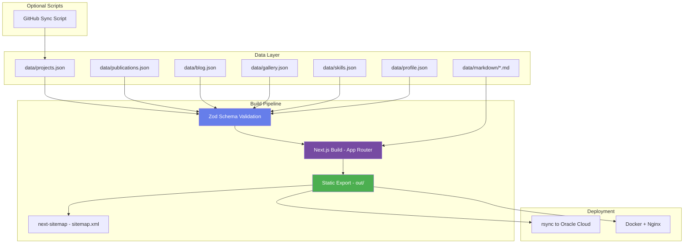
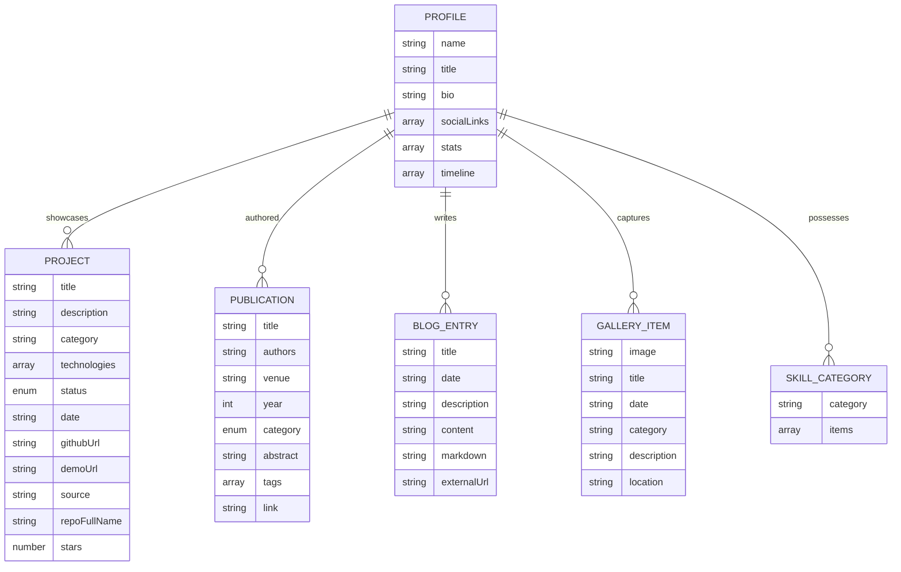

# Design Document: Scalable AI Portfolio

## Overview

This design describes a complete rebuild of Gajendra Mandal's portfolio website using Next.js (App Router) with static export. The architecture is data-driven: all content lives in JSON/Markdown files under a `data/` directory. The build pipeline validates data at build time using Zod schemas, renders pages from validated data, and produces a fully static `out/` directory deployable to any web server (specifically Nginx on Oracle Cloud).

Key design goals:
- Zero-code content updates (add/edit JSON entries or Markdown files)
- Build-time validation with clear error messages
- Static export for maximum performance and simple hosting
- Purple/violet gradient theme matching the existing visual identity
- Accessibility-first approach with reduced-motion support
- GitHub repository auto-sync as an optional enhancement

## Architecture



### Technology Stack

| Layer | Technology | Rationale |
|-------|-----------|-----------|
| Framework | Next.js 14+ (App Router) | Static export support, file-based routing, React Server Components for build-time data loading |
| Language | TypeScript | Type safety, Zod schema inference |
| Validation | Zod | TypeScript-first schema validation with clear error messages at build time |
| Styling | Tailwind CSS | Utility-first CSS matching the gradient theme, responsive design utilities |
| Markdown | remark + rehype | Parse Markdown to HTML with support for code blocks, links, etc. |
| Animations | Framer Motion | Declarative animations with built-in reduced-motion support |
| Sitemap | next-sitemap | Automatic sitemap generation for static exports |
| Image Optimization | sharp + next/image (static) | WebP conversion, lazy loading |
| Deployment | rsync / Docker + Nginx | Simple single-command deployment |
| GitHub Sync | Node.js script (fetch API) | Standalone script calling GitHub REST API |

### Build Flow

1. `npm run build` triggers `next build`
2. Next.js App Router Server Components read JSON files using `fs.readFileSync` at build time
3. Zod schemas validate all data files; validation failures halt the build with descriptive errors
4. Pages render with validated data, producing static HTML/CSS/JS in `out/`
5. `next-sitemap` post-build hook generates `sitemap.xml` and `robots.txt`
6. `npm run deploy` rsyncs `out/` to the remote server

## Components and Interfaces

### Directory Structure

```
├── app/
│   ├── layout.tsx              # Root layout with nav, theme, metadata
│   ├── page.tsx                # Home/Profile page
│   ├── skills/page.tsx         # Skills section
│   ├── projects/page.tsx       # Projects with filtering
│   ├── publications/page.tsx   # Publications with search/filter
│   ├── blog/
│   │   ├── page.tsx            # Blog listing
│   │   └── [slug]/page.tsx     # Individual blog post view
│   └── gallery/page.tsx        # Gallery with lightbox
├── components/
│   ├── layout/
│   │   ├── Navbar.tsx          # Sticky navigation with mobile hamburger
│   │   ├── Footer.tsx          # Site footer
│   │   └── FloatingElements.tsx# Background animated circles
│   ├── ui/
│   │   ├── FilterButtons.tsx   # Reusable category filter component
│   │   ├── SearchInput.tsx     # Debounced search input
│   │   ├── ProjectCard.tsx     # Project display card
│   │   ├── PublicationCard.tsx # Publication display card
│   │   ├── BlogCard.tsx        # Blog entry card
│   │   ├── GalleryGrid.tsx     # Gallery grid with lightbox
│   │   ├── SkillCard.tsx       # Skill category card
│   │   ├── StatCard.tsx        # Statistics card
│   │   ├── Timeline.tsx        # Journey timeline component
│   │   ├── EmptyState.tsx      # Reusable empty/error state
│   │   └── Lightbox.tsx        # Full-screen image overlay
│   └── animations/
│       └── ScrollReveal.tsx    # Intersection Observer entrance animation
├── lib/
│   ├── schemas.ts              # Zod schemas for all data files
│   ├── data.ts                 # Data loading and validation functions
│   ├── markdown.ts             # Markdown parsing utilities
│   └── constants.ts            # Filter categories, theme values
├── data/
│   ├── projects.json
│   ├── publications.json
│   ├── blog.json
│   ├── gallery.json
│   ├── skills.json
│   ├── profile.json
│   └── markdown/               # Blog post markdown files
├── public/
│   ├── images/                 # Gallery and profile images
│   └── files/                  # Resume PDF
├── scripts/
│   ├── sync-github.ts          # GitHub repo sync script
│   └── deploy.sh              # Deployment script
├── next.config.js              # Static export configuration
├── tailwind.config.ts          # Theme configuration
├── Dockerfile                  # Nginx container
├── docker-compose.yml          # Docker deployment
└── .env.example                # Deployment config template
```

### Core Interfaces

```typescript
// lib/schemas.ts - Zod Schemas

import { z } from 'zod';

// Project schema
export const ProjectSchema = z.object({
  title: z.string().max(150),
  description: z.string().max(500),
  category: z.string(),
  technologies: z.array(z.string()).min(1).max(20),
  status: z.enum(['completed', 'ongoing', 'planned']),
  date: z.string().regex(/^\d{4}-\d{2}-\d{2}$/), // ISO 8601 YYYY-MM-DD
  githubUrl: z.string().url().optional(),
  demoUrl: z.string().url().optional(),
  source: z.literal('github').optional(),
  repoFullName: z.string().optional(),
  stars: z.number().optional(),
});

export const ProjectsFileSchema = z.array(ProjectSchema);

// Publication schema
export const PublicationSchema = z.object({
  title: z.string().max(200),
  authors: z.string(),
  venue: z.string(),
  year: z.number().int().min(1900).max(2100),
  category: z.enum(['journal', 'conference', 'workshop', 'preprint', 'book']),
  abstract: z.string().max(1000).optional(),
  tags: z.array(z.string()).max(10).optional(),
  link: z.string().url().optional(),
});

export const PublicationsFileSchema = z.array(PublicationSchema);

// Blog entry schema - exactly one content source
export const BlogEntrySchema = z.object({
  title: z.string().max(150),
  date: z.string().regex(/^\d{4}-\d{2}-\d{2}$/),
  description: z.string().max(300),
  content: z.string().optional(),
  markdown: z.string().optional(),
  externalUrl: z.string().url().optional(),
}).refine(
  (entry) => {
    const sources = [entry.content, entry.markdown, entry.externalUrl]
      .filter(Boolean).length;
    return sources === 1;
  },
  { message: 'Blog entry must have exactly one content source (content, markdown, or externalUrl)' }
);

export const BlogFileSchema = z.array(BlogEntrySchema);

// Gallery schema
export const GalleryItemSchema = z.object({
  image: z.string(),
  title: z.string().max(150),
  date: z.string().regex(/^\d{4}-\d{2}-\d{2}$/),
  category: z.string(),
  description: z.string().max(500).optional(),
  location: z.string().optional(),
});

export const GalleryFileSchema = z.array(GalleryItemSchema);

// Skills schema
export const SkillCategorySchema = z.object({
  category: z.string().max(100),
  items: z.array(z.string()).min(1).max(50),
});

export const SkillsFileSchema = z.array(SkillCategorySchema);

// Profile schema
export const ProfileSchema = z.object({
  name: z.string(),
  title: z.string(),
  bio: z.string().max(2000),
  socialLinks: z.array(z.object({
    label: z.string(),
    url: z.string(),
  })),
  stats: z.array(z.object({
    value: z.string(),
    label: z.string(),
  })).max(10).optional(),
  timeline: z.array(z.object({
    date: z.string(),
    description: z.string(),
  })).max(30).optional(),
});
```

### Component Interfaces

```typescript
// FilterButtons component
interface FilterButtonsProps {
  categories: string[];
  activeCategory: string;
  onCategoryChange: (category: string) => void;
}

// SearchInput component
interface SearchInputProps {
  placeholder: string;
  onSearch: (query: string) => void;
  debounceMs?: number; // default 300ms
}

// ProjectCard component
interface ProjectCardProps {
  project: z.infer<typeof ProjectSchema>;
}

// PublicationCard component
interface PublicationCardProps {
  publication: z.infer<typeof PublicationSchema>;
}

// BlogCard component
interface BlogCardProps {
  entry: z.infer<typeof BlogEntrySchema>;
  slug: string;
}

// Lightbox component
interface LightboxProps {
  image: string;
  title: string;
  description?: string;
  date: string;
  onClose: () => void;
}

// ScrollReveal component
interface ScrollRevealProps {
  children: React.ReactNode;
  threshold?: number; // default 0.1
  duration?: number;  // default 600ms
}

// EmptyState component
interface EmptyStateProps {
  message: string;
  icon?: React.ReactNode;
}
```

### Data Loading Pattern

```typescript
// lib/data.ts
import fs from 'fs';
import path from 'path';
import { ProjectsFileSchema, BlogFileSchema, /* ... */ } from './schemas';

function loadAndValidate<T>(filePath: string, schema: z.ZodType<T>): T {
  const fullPath = path.join(process.cwd(), filePath);
  const raw = fs.readFileSync(fullPath, 'utf-8');
  
  let parsed: unknown;
  try {
    parsed = JSON.parse(raw);
  } catch (e) {
    throw new Error(`Invalid JSON in ${filePath}: ${(e as Error).message}`);
  }
  
  const result = schema.safeParse(parsed);
  if (!result.success) {
    const issues = result.error.issues.map(i => 
      `  - ${i.path.join('.')}: ${i.message}`
    ).join('\n');
    throw new Error(`Validation failed for ${filePath}:\n${issues}`);
  }
  
  return result.data;
}

export function getProjects() {
  return loadAndValidate('data/projects.json', ProjectsFileSchema);
}

export function getBlogEntries() {
  return loadAndValidate('data/blog.json', BlogFileSchema);
}

// ... similar for other data files
```

### Navigation Component

```typescript
// Navbar.tsx - Client component for mobile toggle
'use client';

interface NavItem {
  label: string;
  href: string;
}

const NAV_ITEMS: NavItem[] = [
  { label: 'Home', href: '/' },
  { label: 'Skills', href: '/skills' },
  { label: 'Projects', href: '/projects' },
  { label: 'Publications', href: '/publications' },
  { label: 'Blog Posts', href: '/blog' },
  { label: 'Gallery', href: '/gallery' },
];
```

## Data Models

### Entity Relationship



### Data File Specifications

| File | Format | Validation | Max Entries |
|------|--------|-----------|-------------|
| `data/projects.json` | JSON array | Zod `ProjectsFileSchema` | Unbounded (practical: ~100 from GitHub sync) |
| `data/publications.json` | JSON array | Zod `PublicationsFileSchema` | Unbounded |
| `data/blog.json` | JSON array | Zod `BlogFileSchema` | Unbounded |
| `data/gallery.json` | JSON array | Zod `GalleryFileSchema` | Unbounded |
| `data/skills.json` | JSON array | Zod `SkillsFileSchema` | Unbounded |
| `data/profile.json` | JSON object | Zod `ProfileSchema` | Single object |

### Blog Content Resolution

Blog entries have exactly one content source, resolved as follows:

| Field | Resolution |
|-------|-----------|
| `content` | Inline Markdown string, parsed at build time |
| `markdown` | Relative file path; file read and parsed at build time |
| `externalUrl` | External link; card renders with external indicator, opens in new tab |

### GitHub Sync Data Flow

The sync script produces entries with additional fields:
- `source: "github"` — identifies auto-synced entries
- `repoFullName` — unique key for update matching (e.g., `gajendramandal/repo-name`)
- `stars` — stargazers count from the API

Manual entries (without `source: "github"`) are never modified by the sync script.


## Correctness Properties

*A property is a characteristic or behavior that should hold true across all valid executions of a system — essentially, a formal statement about what the system should do. Properties serve as the bridge between human-readable specifications and machine-verifiable correctness guarantees.*

### Property 1: Schema validation accepts valid data and rejects invalid data

*For any* data object that conforms to all field constraints (correct types, within length limits, valid enum values, array bounds satisfied), the corresponding Zod schema SHALL accept it. *For any* data object that violates at least one constraint, the schema SHALL reject it with a validation error.

**Validates: Requirements 1.1, 1.2, 1.4, 1.5, 1.6**

### Property 2: Blog entry exactly-one-source constraint

*For any* blog entry object, validation SHALL pass if and only if exactly one of the fields `content`, `markdown`, or `externalUrl` is defined (non-undefined/non-null). Entries with zero or more than one source SHALL be rejected.

**Validates: Requirements 1.3, 1.9**

### Property 3: Validation errors reference correct file and field path

*For any* invalid data object passed to the validation layer, the resulting error message SHALL contain the file path and the specific field path (e.g., `[2].title`) that caused the failure.

**Validates: Requirements 1.8**

### Property 4: Category filtering returns only matching items

*For any* list of items (projects or publications) and any selected category (other than "All"), the filtered output SHALL contain only items whose category matches the selected value, and SHALL contain all items from the input that match.

**Validates: Requirements 2.3**

### Property 5: Publication search with category filter applies AND condition

*For any* list of publications, any search query string, and any active category filter, the resulting set SHALL contain only publications that match BOTH the search query (present in title, authors, or year) AND the selected category. When category is "All", only the search condition applies.

**Validates: Requirements 3.3**

### Property 6: Dynamic category derivation from data

*For any* gallery data array, the set of filter categories SHALL equal the set of unique `category` values present in the data, plus an "All" option. No categories shall be missing or spuriously added.

**Validates: Requirements 5.3**

### Property 7: Text truncation preserves content within length limits

*For any* string input and a maximum length N, the truncation function SHALL return: the original string unchanged if its length is ≤ N, or the first N characters followed by "…" if longer. The output length SHALL never exceed N + 1 (accounting for the ellipsis character).

**Validates: Requirements 2.4, 3.4**

### Property 8: Optional field omission produces no broken output

*For any* project entry where `githubUrl` or `demoUrl` is undefined, the rendered card output SHALL not contain a link element for the missing field. For entries where these fields ARE defined, the corresponding link SHALL be present with the correct URL.

**Validates: Requirements 2.6**

### Property 9: Date-based sorting produces correct descending order

*For any* list of entries with date fields, the sorted output SHALL be in strictly non-ascending date order (newest first). For entries with equal dates, relative order from the input SHALL be preserved (stable sort).

**Validates: Requirements 4.1, 6.4**

### Property 10: Markdown parsing produces valid HTML containing expected elements

*For any* Markdown string containing headings, bold text, links, or code blocks, the parsed HTML output SHALL contain the corresponding HTML elements (`<h1>`–`<h6>`, `<strong>`, `<a>`, `<code>`/`<pre>`). The output SHALL be valid HTML (no unclosed tags).

**Validates: Requirements 4.2**

### Property 11: Input order preservation in rendering

*For any* skills data array, the rendered output SHALL display skill categories in the same order as they appear in the input array. The i-th rendered card SHALL correspond to the i-th element of the input.

**Validates: Requirements 7.2**

### Property 12: GitHub API response transformation correctness

*For any* GitHub API repository response object, the transformation function SHALL produce a project entry where: title equals repo name, description equals repo description (or empty string if null), technologies includes the primary language (if non-null) and all topics, githubUrl equals the repo HTML URL, and source equals "github".

**Validates: Requirements 10.2**

### Property 13: GitHub sync merge preserves manual entries and correctly upserts

*For any* existing projects array containing a mix of manual entries (no `source` field) and GitHub-sourced entries, and any new GitHub sync data, the merge operation SHALL: (a) preserve all manual entries exactly as-is, (b) update existing GitHub-sourced entries matched by `repoFullName`, and (c) add new GitHub repos not present in existing data.

**Validates: Requirements 10.3, 10.4**

### Property 14: Meta tag length constraints

*For any* page metadata generation, the title output SHALL not exceed 60 characters and the description output SHALL not exceed 160 characters. If input data exceeds these limits, the output SHALL be truncated appropriately.

**Validates: Requirements 12.1**

## Error Handling

### Build-Time Errors

| Error Condition | Behavior | User Feedback |
|----------------|----------|---------------|
| Invalid JSON in data file | Build fails immediately | Error message with file path and JSON parse error |
| Missing required field | Build fails | Error with file path, entry index, and field name |
| Field constraint violation (length, enum, etc.) | Build fails | Error with specific constraint that failed |
| Blog entry with 0 or >1 content sources | Build fails | Error identifying the blog entry |
| Referenced Markdown file not found | Build fails | Error with file path that couldn't be resolved |

### Runtime Errors (Client-Side)

| Error Condition | Behavior | User Feedback |
|----------------|----------|---------------|
| Image fails to load | Show placeholder | Broken image replaced with styled placeholder |
| Lightbox image fails | Close lightbox | Display error message in lightbox area |
| Filter produces no results | Show empty state | "No matching items found" message |
| Search produces no results | Show empty state | "No publications match your search" |

### Deployment Errors

| Error Condition | Behavior | User Feedback |
|----------------|----------|---------------|
| Build fails before deploy | Halt deployment | stderr error message, non-zero exit |
| SSH/rsync connection fails | Halt deployment | Connection error with host details |
| Missing env variables | Halt deployment | "Missing required variable: DEPLOY_HOST" |
| GitHub API rate limit | Sync fails | Error with rate limit reset time |
| GitHub API timeout (>30s) | Sync fails | Timeout error, existing file unchanged |

### Error Design Principles

1. **Fail fast at build time**: Data validation errors prevent deployment of broken content
2. **Graceful degradation at runtime**: Client-side errors show informational messages, never blank screens
3. **Atomic operations**: The sync script and deploy script never leave files in a partially-updated state
4. **Descriptive messages**: All errors include enough context (file, entry, field) for immediate debugging

## Testing Strategy

### Property-Based Testing

**Library**: [fast-check](https://github.com/dubzzz/fast-check) (TypeScript property-based testing library)

**Configuration**: Minimum 100 iterations per property test.

**Tag format**: `Feature: scalable-ai-portfolio, Property {number}: {property_text}`

Properties 1–14 from the Correctness Properties section will each be implemented as a single property-based test using fast-check arbitraries to generate random inputs.

Key generators needed:
- `arbitraryProject()` — generates valid/invalid project objects
- `arbitraryPublication()` — generates valid/invalid publication objects
- `arbitraryBlogEntry()` — generates blog entries with varying content source combinations
- `arbitraryGalleryItem()` — generates gallery items
- `arbitrarySkillCategory()` — generates skill categories
- `arbitraryProfile()` — generates profile objects
- `arbitraryGitHubRepo()` — generates GitHub API response objects
- `arbitraryMarkdown()` — generates Markdown strings with various elements

### Unit Tests (Example-Based)

| Area | Test Cases |
|------|-----------|
| Status badge colors | "completed" → green, "ongoing" → amber, "planned" → purple |
| Date formatting | ISO date → "MMM DD, YYYY" format |
| External blog card | Renders with external indicator and `target="_blank"` |
| Nav links | All 6 section links present |
| Empty states | Each section renders correct empty message |
| Responsive nav | Hamburger visible below 768px |
| Lightbox interactions | Escape key closes, click outside closes |
| Default meta tags | Fallback values used when page-specific data absent |

### Integration Tests

| Area | Test Cases |
|------|-----------|
| Full build | Valid data → static output in `out/` |
| Sitemap generation | `sitemap.xml` contains all page URLs |
| GitHub sync (mocked) | API response correctly transforms and merges |
| Deploy script (dry-run) | Correct rsync command constructed |
| Markdown rendering | `.md` file → rendered HTML in blog post page |

### Accessibility Tests

- All images have alt text
- Color contrast meets WCAG AA (4.5:1 for text)
- Keyboard navigation through all interactive elements
- `prefers-reduced-motion` disables animations
- Focus indicators visible on all interactive elements
- Lightbox traps focus and is dismissible via keyboard

### Performance Tests

- Lighthouse CI in CI/CD pipeline (desktop > 90, mobile > 80)
- Bundle size monitoring (< 200KB JS initial load)
- Image optimization verification (WebP output, lazy loading attributes)

